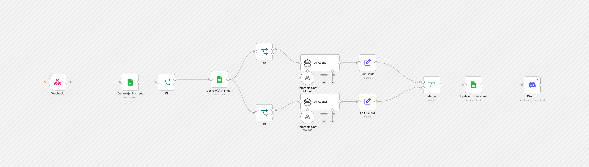

# Discord Caption Generator

A webhook pulls the next row from Google Sheets. Two Claude agents write and refine a caption, the caption is written back to the sheet, and the result is posted to a Discord channel.

## At a glance

- Nodes: 15
- Integrations: discord, googleSheets, lmChatAnthropic

## Setup

1. In n8n, open **Workflows → Import from File** and select the JSON.
2. Create these credentials and select them on the nodes that need them: `anthropicApi`, `discordWebhookApi`, `googleSheetsOAuth2Api`.
3. Replace the placeholders below with your own values.

## Placeholders

Values were removed from the export and replaced with:

- `YOUR_GOOGLE_SHEETS_ID`
